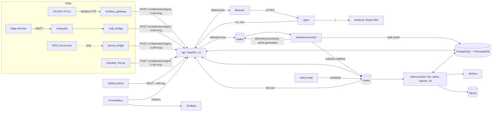
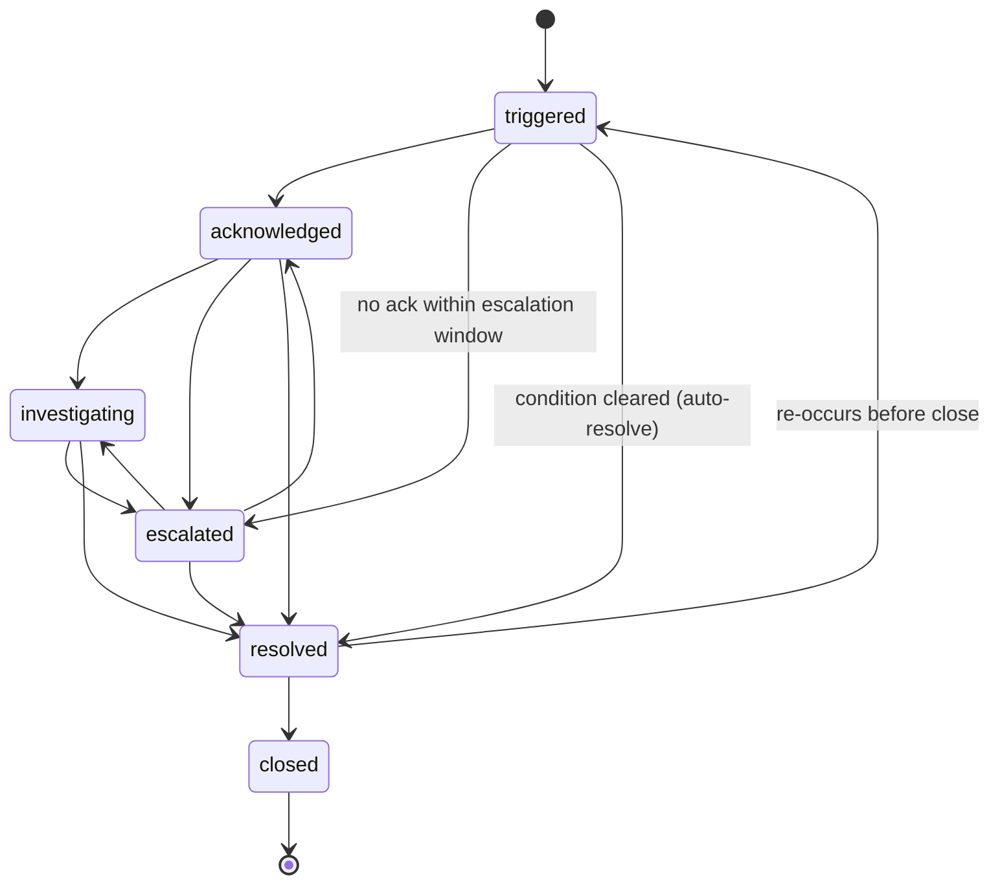
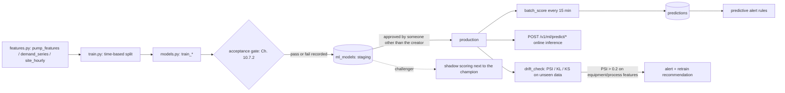

# Architecture

This document shows how the specification's architecture (Ch. 3, 5, 9, 15) is realised in this
repository. Diagram numbers refer to the spec's figures where one exists.

## 1. Container topology (Ch. 15.2)



Every arrow in this diagram exists in code. The process that runs each one:

| Service | Entrypoint |
|---|---|
| api | `app.main:create_app` (gunicorn + uvicorn workers) |
| stream-processor | `python -m app.integration.kafka_consumer`, consumer group `stream-processor` |
| celery-worker / beat | `app.workers.celery_app`; queues `kpi`, `alerts`, `reports`, `ml` |
| mqtt-bridge | `python -m app.integration.mqtt_bridge` |
| Modbus | `app.integration.modbus_gateway`, a polling register map |
| simulator | `scripts/simulate_live.py` |
| Airflow | `airflow/dags/aquaintel_ml_pipeline.py` |

### Degraded / single-process mode

The platform has two runtime switches. Both keep the same service code; only the transport changes.

| Setting | Production | Laptop / CI |
|---|---|---|
| `AQUAINTEL_EVENT_BUS` | `kafka`: producer with acks=all, keyed by asset id | `auto` → `MemoryEventBus` with the same topics, DLQ and handler contract |
| `AQUAINTEL_TASK_MODE` | `celery` (broker: Redis db 1) | `inline`: asyncio tasks plus an in-process cron scheduler |
| `AQUAINTEL_ML_ORCHESTRATOR` | `airflow` (DAGs own retraining) | `celery` (beat runs the Table 10.2 calendar) |
| Redis | `RedisCache` | `MemoryCache` (same interface) |
| MinIO | `MinioStore` | `LocalStore` (filesystem, same `ObjectStore` protocol) |

`/health` reports the active backend for each dependency. Running on a fallback shows as
`degraded`, not `unhealthy`.

## 2. Telemetry ingestion workflow (Ch. 5.3.1)

```mermaid
sequenceDiagram
  participant A as Adapter (Modbus / MQTT / REST / CSV)
  participant API as POST /v1/telemetry/ingest
  participant V as validation.py
  participant K as Kafka telemetry.raw
  participant P as TelemetryPipeline
  participant DB as telemetry_data (hypertable)
  participant RE as RulesEngine
  participant AS as AlertService
  participant WS as WebSocket clients
  A->>API: batch of points (tag, time, value, quality)
  API->>V: range / rate-of-change / z-score / quality checks
  V-->>API: accepted + rejected (with reasons; rejections counted in Prometheus)
  API->>K: envelope keyed by asset_id (per-asset ordering)
  API-->>A: 202 {accepted, rejected, errors}
  K->>P: consume
  P->>DB: INSERT ... ON CONFLICT DO NOTHING (idempotent replay)
  P->>RE: evaluate rules for the touched tags (rule cache invalidated on rule edits)
  RE->>AS: AlertOutcome (raise / update / clear)
  AS->>AS: dedup, cooldown, flood control, maintenance suppression, correlation
  P->>WS: latest values + alerts via Redis pub/sub
```

## 3. Alert lifecycle (Figure 13.1)



`ALLOWED_TRANSITIONS` in `services/alert_service.py` is the single source of truth for these
transitions. An illegal transition raises `InvalidStateTransition`, which returns HTTP 422 naming the rejected move. Every
transition writes an `alert_events` row and an audit record. Escalation follows the matrix in
Table 13.1 (`ESCALATION_MATRIX`) and is driven by the `escalate_alerts` job every minute.

## 4. Backend layering (Ch. 9)

```
api/v1/*        HTTP only: parse, authorise (require_permission / ABAC scope), call one service, wrap in envelope
services/*      business rules and transactions; publish events; write audit records
repositories/*  SQLAlchemy queries only (BaseRepository: get / list / paginate / create / update / delete)
models/*        ORM entities (26 tables); enums.py mirrors the spec's enumerations
schemas/*       Pydantic v2 request/response contracts
core/*          config, security, permissions, cache, events, resilience, logging, metrics, storage
ml/, optimization/, integration/, workers/   domain engines and process entrypoints
```

The rules:

* **Routers stay thin.** They validate input, check permissions, turn query-string filters into
  conditions for a repository, and hand anything with a business rule to a service, for example
  `RuleService` for duplicate-rule checks. A few writes with no business rule, such as registering
  a tag or removing a report schedule, go straight through a repository.
* **Routers never build raw SQL** and never return ORM objects unserialised.
* **Every cross-cutting concern lives in middleware or `core/`:**
  * request ID
  * timing and body-size limit
  * rate limiting (sliding window in Redis)
  * security headers (CSP, `nosniff`, frame denial, `no-store` on `/v1`)
  * CORS
  * exception → error envelope mapping, including database constraint errors → 409/422

**Resilience (Ch. 9.10).** `pybreaker` circuit breakers wrap Kafka, MLflow, SMTP and SMS. `tenacity`
retries transient database and HTTP errors. The bulkhead is that the API never trains models in a
request: training is dispatched to the `ml` queue.

## 5. Data model (Ch. 6)

| Area | Tables |
|---|---|
| Identity & access | `users`, `roles`, `api_keys`, `audit_log` (hash chain, immutable trigger) |
| Assets | `asset_types`, `assets` (adjacency list plus a materialised `path` for subtree queries and ABAC), `spare_parts` |
| Telemetry | `telemetry_tags`, `telemetry_data` (hypertable, 7-day chunks, compressed after 30 days, retained 2 years) |
| Aggregates | `telemetry_hourly` (continuous aggregate), `telemetry_daily` (materialised view with percentiles), `kpi_daily` |
| Alerts | `alert_rules`, `alerts`, `alert_events`, `incidents`, `notifications` |
| KPIs | `kpi_definitions`, `kpi_values` (hypertable, retained 1 year) |
| Reporting & compliance | `reports`, `report_schedules`, `regulatory_limits` |
| Maintenance | `work_orders` |
| ML | `ml_models` (registry: version, stage, metrics, acceptance, baseline profile), `predictions` (hypertable, 90 days) |
| Dashboards & system | `dashboards`, `dashboard_widgets`, `schedules`, `system_config` |

Read paths use views: `active_alerts_summary`, `asset_health_scores` and
`daily_compliance_summary`. The telemetry aggregate router (`telemetry_repository.aggregate`)
picks raw, hourly or daily data from the requested window, so a 90-day chart reads about 90 rows
per tag instead of about 130 k. Indexes:

* BRIN on time columns
* HASH on `tag_id` for equality lookups
* composite `(tag_id, time DESC)` for "latest value" queries, which use `DISTINCT ON`

Without TimescaleDB, migration 0002 creates plain tables and ordinary views with the same names,
so the application code does not branch on it.

## 6. ML lifecycle (Ch. 10, 14)



How the drift monitor works:

* **What it compares.** Only data *after* the training window is scored. Until 20 rows of unseen
  data exist, it reports `collecting`.
* **Reference.** The last 30 days of training data, so a long seasonal trend does not dominate.
* **Seasonal inputs.** Weather-driven inputs (water and air temperature, TOC, seasonal demand level)
  are reported but cannot raise an alert. Seasonal shift there is expected, and the Table 10.2
  retraining calendar absorbs it.

## 7. Frontend (Ch. 8)

```
src/api/         RTK Query slices per bounded context; baseApi handles re-auth (refresh rotation) and envelopes
src/store/       authSlice, uiSlice (theme, site, sidebar) with localStorage persistence middleware
src/features/    one folder per area; each page is lazy-loaded and wrapped in RequirePermission
src/components/  charts (Recharts + D3 HeatMap / AssetMap), widgets (KpiCard + BandBar, AlertList,
                 AssetTree, virtualised TelemetryTable), layout (AppShell, Sidebar, Header), common
src/hooks/       useWebSocket (reconnect with backoff, topic subscribe), usePermissions, usePolling …
```

* **Real-time data.** One WebSocket per tab carries telemetry and alert events. Telemetry goes
  straight to subscribed charts and tables. An alert event raises a toast, is announced to screen
  readers, and invalidates the alert cache tags so open lists refetch. Acknowledging an alert
  patches the cached lists optimistically and rolls back if the API rejects it.
* **Visual language (ISA-101).**
  * Neutral surfaces by default.
  * Alarm colours (critical #E5484D, major #F2994A, minor #E9C46A) appear only for abnormal states.
  * IBM Plex Sans with tabular numerals.
  * The KPI **BandBar** shows the value against its warning and critical bands, so the status is
    readable without colour.
* **Time zones.**
  * The database stores UTC (`TIMESTAMPTZ`), and the API sends ISO-8601 with an offset.
  * The UI shows every time in the *viewer's* zone, and the header names it (e.g. `GMT+5:30`).
  * Plant behaviour that depends on the clock follows the *plant's* zone (`AQUAINTEL_TZ`,
    `core/timeutil.py`): tariff windows, the diurnal demand curve, ML calendar features, alert
    silent hours and report cron schedules. A 17:00–22:00 peak tariff therefore means 17:00–22:00
    on the plant's wall clock, whatever zone the servers run in.

## 8. Security (Ch. 17)

* **Passwords:** Argon2id hashing, with lockout after repeated failures. The login rate limit is
  5 per minute per IP.
* **Tokens:** HS256 JWT access tokens (60 min). Refresh tokens (7 days) rotate on every use; a
  rotated refresh token that is reused revokes every session of that user, and logout blacklists the token's `jti`.
* **MFA:** optional per-user TOTP. When it is enabled, login returns a short-lived MFA challenge
  token, and tokens are issued only after the code is verified.
* **API keys:** stored as bcrypt hashes and shown once. Each key carries an explicit permission list,
  and integrations get only what they need, for example `telemetry:ingest`.
* **RBAC:** `core/permissions.py` encodes Table 17.1. Routers declare `require_permission("x:y")`,
  and the UI hides what the role cannot do.
* **ABAC:** a user's `asset_scopes` (globs such as `plant_a/*`) filter asset, telemetry, alert and
  KPI queries, and are checked again on every write.
* **Audit:** every state-changing action is recorded and chained (`hash = sha256(prev_hash + record)`).
  `GET /v1/admin/audit-log/verify` recomputes the chain, and the database trigger rejects
  `UPDATE`/`DELETE` on `audit_log`.
* **Network:** Kubernetes NetworkPolicies are default-deny. The data tier accepts connections only
  from application pods, and `/metrics` is never routed publicly.
* **Accounts:** there is no public sign-up. The first administrator is created from a server shell
  with `scripts/create_admin.py`; everyone else is created in *Admin → Users*.
* **Secrets:** outside development and test, the API refuses to start with the default or a
  placeholder signing key.
* **Input:**
  * every request schema rejects `Infinity`/`NaN`, trims text and bounds its length;
  * every numeric query parameter has upper and lower limits;
  * Excel exports never contain live formulas;
  * PDF text is escaped.
* **Browser:** a strict Content-Security-Policy (`script-src 'self'`, no inline scripts). Fonts and
  libraries are bundled, so the UI makes no third-party requests and works on an isolated plant
  network.
* **Supply chain:** CI runs `pip-audit` and `npm audit` (both clean at delivery), plus a gitleaks scan
  and a check that no `.env`, key or database file is ever tracked.

How each item was verified against the QA audit of the earlier prototype is recorded in
[`QA_AUDIT_RESPONSE.md`](QA_AUDIT_RESPONSE.md).
